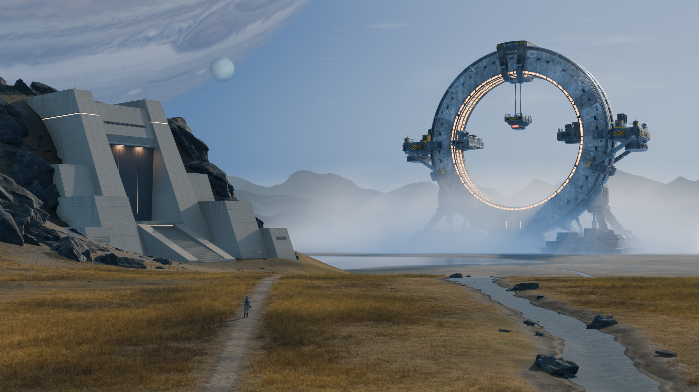
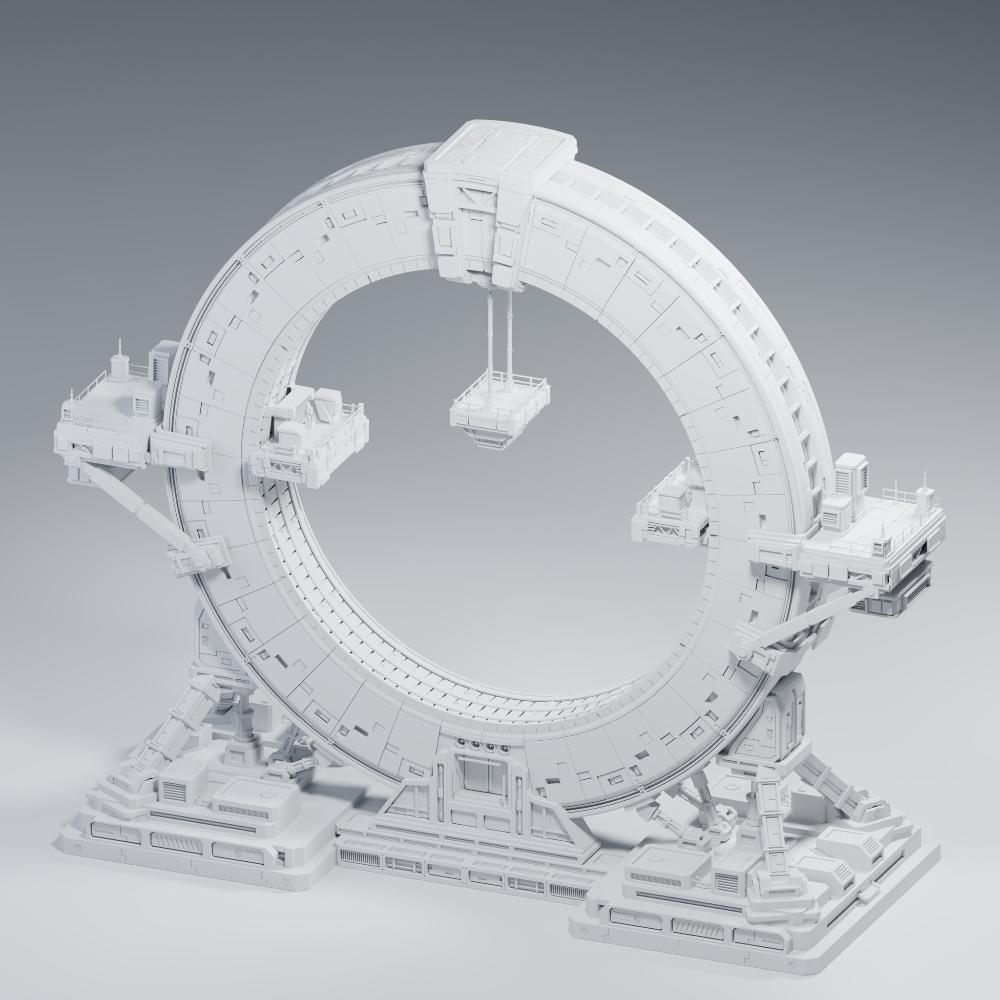

# AI + Blender · Megastructure Workflow

A cinematic sci-fi environment built through concept references, focused prompts, Codex-assisted Blender work, and repeated visual review.

*Final Blender render: a giant mechanical ring, hillside bunker, shallow stream and distant planetary sky. The approved image is 3840 × 2160.*

## English

### Project

The ring is the main subject, the bunker is secondary, and the figure, path, water and mountains establish scale and depth. The project follows the full process from concept planning to an editable Blender scene and a finished image.

| Tool | Role |
| --- | --- |
| ChatGPT on the web | Design analysis, prompt planning, isolated asset references and orthographic reference images |
| NeoWow | The two chosen scene targets, FinalRef and Ref2 |
| Codex | Focused modeling, material, lighting and rendering tasks in Blender |
| Blender | Actual geometry, materials, cameras, atmosphere, compositing and final renders |
| Human review | Composition decisions, corrections, approval and version rollback |

### Explore the workflow

- [Illustrated workflow — English first, Chinese second](docs/Workflow_EN_CN.md)
- [Download the illustrated PDF](docs/Megastructure_Workflow_EN_CN.pdf)
- [Prompt library: 37 reference-design instructions and 24 production-refinement prompts](docs/Prompt_Index_EN_CN.md)
- [Ring gallery: three full views and seven component details](docs/Gallery_EN_CN.md)
- [Blender file guide](docs/Blender_Files_EN_CN.md)
- [Reference roles and asset credits](docs/Credits_EN_CN.md)

The workflow covers extracting the ring from the concept, generating modeling views, building a repeatable arc segment, assembling the environment, refining water and concrete, resolving mountain depth and planetary compositing, replacing the figure, and finishing the lighting and 4K render. Intermediate experiments are explained alongside the choices retained in the final scene.

### Download the Blender projects

The editable projects are available in [Releases](https://github.com/supercoderrrrr/AI_Blender/releases/tag/1.0).

| File | Contents | Download |
| --- | --- | --- |
| `Megastructure_Final_Scene.blend` | Final environment, approved camera and lighting, packed images, planet source scenes and delivery compositor | [Final scene · ~284 MB](https://github.com/supercoderrrrr/AI_Blender/releases/download/1.0/Megastructure_Final_Scene.blend) |
| `Industrial_Ring_Clay.blend` | Final ring geometry with a clay override and matching showcase camera | [Clay study · ~6.6 MB](https://github.com/supercoderrrrr/AI_Blender/releases/download/1.0/Industrial_Ring_Clay.blend) |
| `Industrial_Ring_Material_Showcase.blend` | Isolated ring with final materials, industrial lights, studio lighting and ten saved display scenes | [Material showcase · ~6.9 MB](https://github.com/supercoderrrrr/AI_Blender/releases/download/1.0/Industrial_Ring_Material_Showcase.blend) |
| `Megastructure_Final.png` | Approved 3840 × 2160, 16-bit RGB final image | [Full-resolution image · ~32 MB](https://github.com/supercoderrrrr/AI_Blender/releases/download/1.0/Megastructure_Final.png) |

**Open with Blender 5.2.2 LTS**, the version used for delivery. Images are packed and the projects have no linked external Blender libraries. In the material showcase, choose a scene from the scene selector and press F12 to render its saved view. Set a suitable Cycles device for your hardware.

The main environment uses EEVEE at 4K with 192 samples. The showcase uses Cycles at 192 samples with denoising. The final scene also includes `Final Image | Region Assembly` to recompose the packed full-resolution render regions. Planet source scenes remain editable; their rendered images are updated manually in the main compositor. See the [file guide](docs/Blender_Files_EN_CN.md) for the scene names and details.

### Ring showcase

| Three-quarter | Front | Rear |
| --- | --- | --- |
|  |  |  |

| Clay study | Final materials |
| --- | --- |
|  |  |

*The clay and material studies share the final ring geometry and camera. The independent studio preserves the environment's procedural texture scale and adjusts light energy to the local asset scale.*

| Upper crown and suspension mount | Side platform and mounting structure |
| --- | --- |
|  |  |

| Foundation and support joints | Mechanical pivot and bearing |
| --- | --- |
|  |  |

[See all ten views, including the suspended core, platform underside and inner light channel →](docs/Gallery_EN_CN.md)

Web images are resized JPEG previews for convenient browsing. The release includes the original final scene PNG. All final scene and showcase pictures are actual Blender renders.

### Reference and asset credits

External references were collected mainly through ArtStation. FinalRef and Ref2 were generated with NeoWow; the principal ring reference is “未来工业环形空间门” (Future Industrial Ring Portal). Jupiter uses [Hubble Jupiter Global Map 2019](https://science.nasa.gov/asset/hubble/jupiter-global-map-2019/), credited to NASA, ESA, A. Simon and M. H. Wong. The D3_IDLE2 figure, Neptune reference and rock textures were supplied separately for the project. Individual reference roles and the available attribution are recorded in [Credits](docs/Credits_EN_CN.md).

---

## 中文

### 项目简介

这是一次从概念参考、提示词规划、Codex 辅助制作，到 Blender 最终出图的完整实践。巨型圆环是画面主角，山坡地堡是次要焦点，人物、道路、水面和远山建立尺度与纵深。

*最终 Blender 渲染：巨型机械圆环、山坡地堡、浅溪与远处的行星天空。批准的成图为 3840 × 2160。*

| 工具 | 职责 |
| --- | --- |
| GPT 网页版 | 设计分析、提示词规划、独立资产参考和正交参考图 |
| NeoWow | 制作选定的 FinalRef、Ref2 两张目标场景参考 |
| Codex | 在 Blender 中完成有明确范围的建模、材质、灯光和渲染任务 |
| Blender | 保存真实几何、材质、相机、氛围、合成与最终渲染 |
| 人工审阅 | 决定构图、纠错、批准结果和回退版本 |

### 阅读制作流程

- [带图完整流程：前英文、后中文](docs/Workflow_EN_CN.md)
- [下载图文 PDF](docs/Megastructure_Workflow_EN_CN.pdf)
- [提示词库：37 条参考设计任务、24 条制作修正任务](docs/Prompt_Index_EN_CN.md)
- [圆环展示图库：3 张整体、7 张零件细节](docs/Gallery_EN_CN.md)
- [Blender 工程使用说明](docs/Blender_Files_EN_CN.md)
- [参考图职责与素材来源](docs/Credits_EN_CN.md)

流程涵盖：从母图提取圆环、生成建模视图、制作可重复弧段、搭建环境、修复溪流和混凝土、调整远山层次与行星合成、替换人物，以及最终光照和 4K 出图。正文同时记录中间试验和终稿取舍，方便理解每一步为何调整。

### 下载三份 Blender 工程

可编辑工程位于 [Releases 下载区](https://github.com/supercoderrrrr/AI_Blender/releases/tag/1.0)，文件名不带项目迭代版本号。

| 文件 | 内容 | 下载 |
| --- | --- | --- |
| `Megastructure_Final_Scene.blend` | 最终环境、批准的相机和光照、打包图像、行星源场景和交付合成 | [最终场景 · 约 284 MB](https://github.com/supercoderrrrr/AI_Blender/releases/download/1.0/Megastructure_Final_Scene.blend) |
| `Industrial_Ring_Clay.blend` | 最终圆环几何、白模材质覆盖和对应展示机位 | [圆环白模 · 约 6.6 MB](https://github.com/supercoderrrrr/AI_Blender/releases/download/1.0/Industrial_Ring_Clay.blend) |
| `Industrial_Ring_Material_Showcase.blend` | 独立圆环材质、工业灯光、摄影棚灯光和十个展示场景 | [材质展示版 · 约 6.9 MB](https://github.com/supercoderrrrr/AI_Blender/releases/download/1.0/Industrial_Ring_Material_Showcase.blend) |
| `Megastructure_Final.png` | 批准的 3840 × 2160、16 位 RGB 最终图片 | [完整分辨率成图 · 约 32 MB](https://github.com/supercoderrrrr/AI_Blender/releases/download/1.0/Megastructure_Final.png) |

**使用交付时的 Blender 5.2.2 LTS 打开。** 图像已打包，工程没有外部链接的 Blender 库。材质展示版通过场景选择器切换机位，按 F12 可重渲；请按电脑硬件设置适合的 Cycles 渲染设备。

最终环境使用 EEVEE、4K 和 192 采样；独立展示使用 Cycles、192 采样和降噪。最终工程中的 `Final Image | Region Assembly` 可以重组打包的完整分辨率分区渲染。行星源场景可编辑，重新渲染后需要手动更新主合成器内的行星图像。具体场景名称见[工程说明](docs/Blender_Files_EN_CN.md)。

### 圆环展示与细节

整体视角包括三分之四、正面和背面。细节覆盖顶部吊装、悬挂核心、侧平台、平台底部、底座接头、内圈灯槽和机械转轴。白模与材质版使用同一套最终几何和同一个机位，方便比较结构与表面效果。

[查看全部单张展示图 →](docs/Gallery_EN_CN.md)

网页使用缩放压缩后的 JPEG 预览，便于浏览；Releases 中另提供完整分辨率的最终场景 PNG。最终成图和展示图均为真实 Blender 渲染。

### 参考与素材来源

外部参考主要经由 ArtStation 搜集；FinalRef、Ref2 由 NeoWow 生成；主要圆环参考是“未来工业环形空间门”。木星使用 [Hubble Jupiter Global Map 2019](https://science.nasa.gov/asset/hubble/jupiter-global-map-2019/)，署名 NASA、ESA、A. Simon、M. H. Wong。D3_IDLE2 人物、海王星参考和岩石纹理由项目另行提供。参考图职责和现有署名信息见[素材来源](docs/Credits_EN_CN.md)。
