# Industrial ring gallery

Three full views and seven component details, rendered in Blender with the final ring geometry. Web images are resized JPEG previews; the original renders use 16-bit RGB PNG and Cycles at 192 samples.

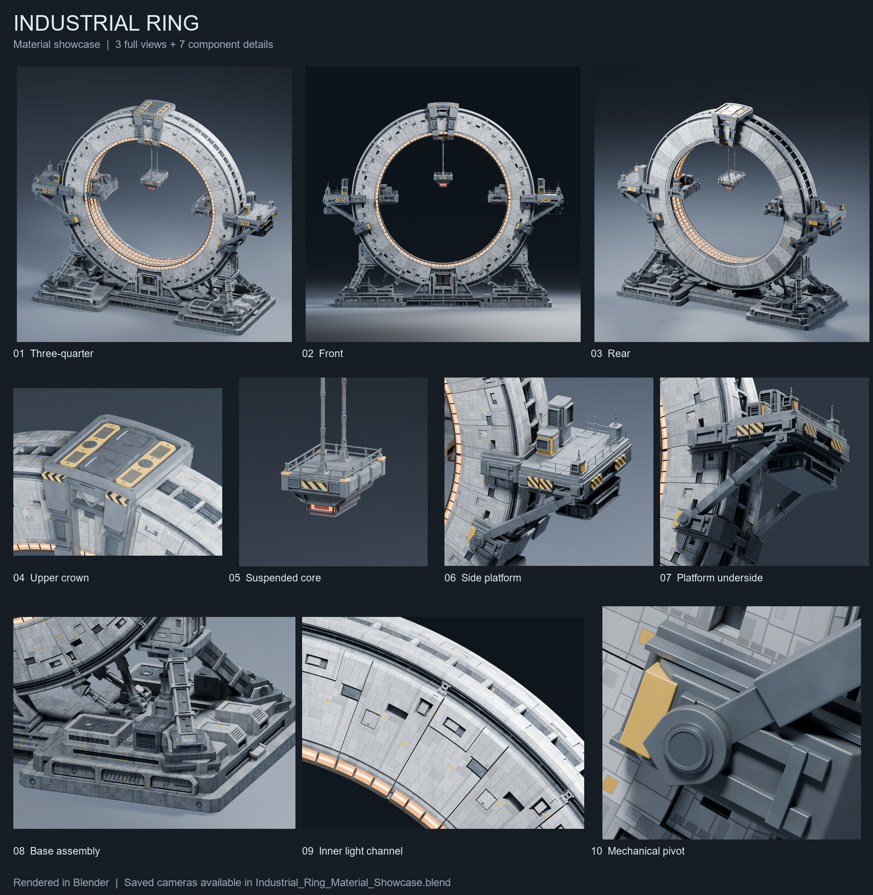

## 01 — Full ring, three-quarter view

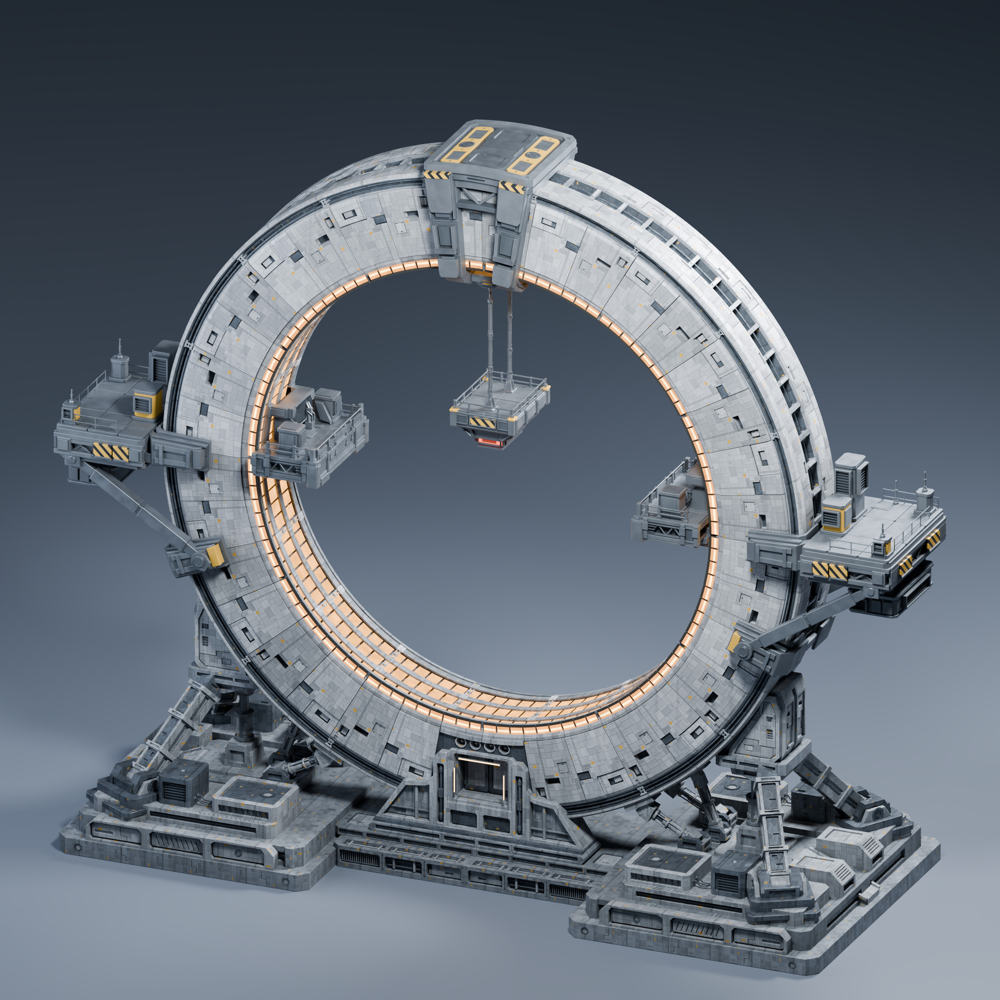

Saved scene: `01 | Ring - Three Quarter`. Original render: 2560 × 2560.

## 02 — Full ring, front elevation

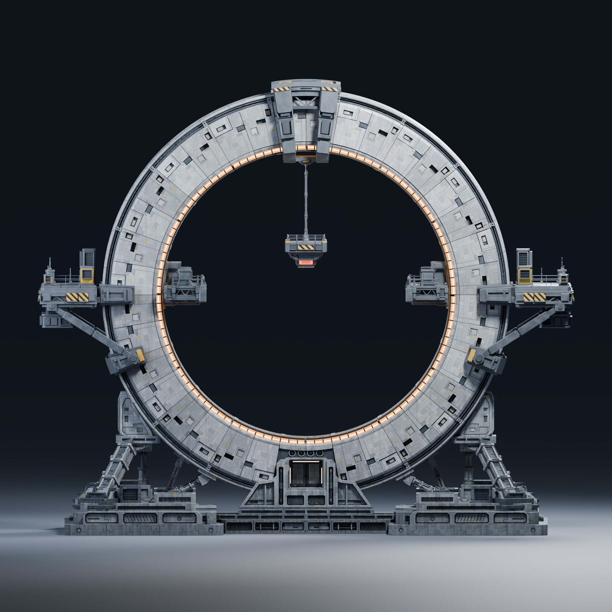

Saved scene: `02 | Ring - Front`. Original render: 2560 × 2560.

## 03 — Full ring, rear three-quarter view

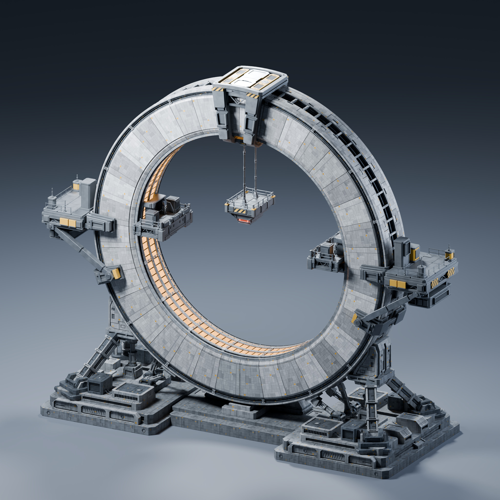

Saved scene: `03 | Ring - Rear`. Original render: 2560 × 2560.

## 04 — Upper crown, clamp and industrial panels

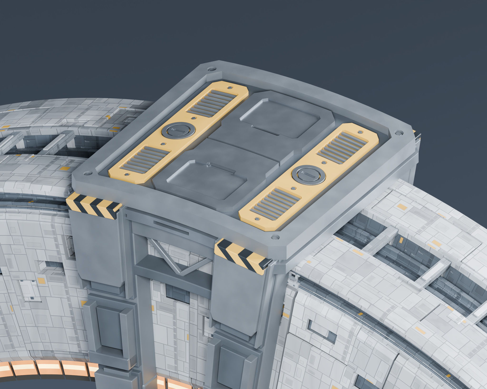

Saved scene: `04 | Detail - Upper Crown`. Original render: 2400 × 1920.

## 05 — Suspended service platform and core

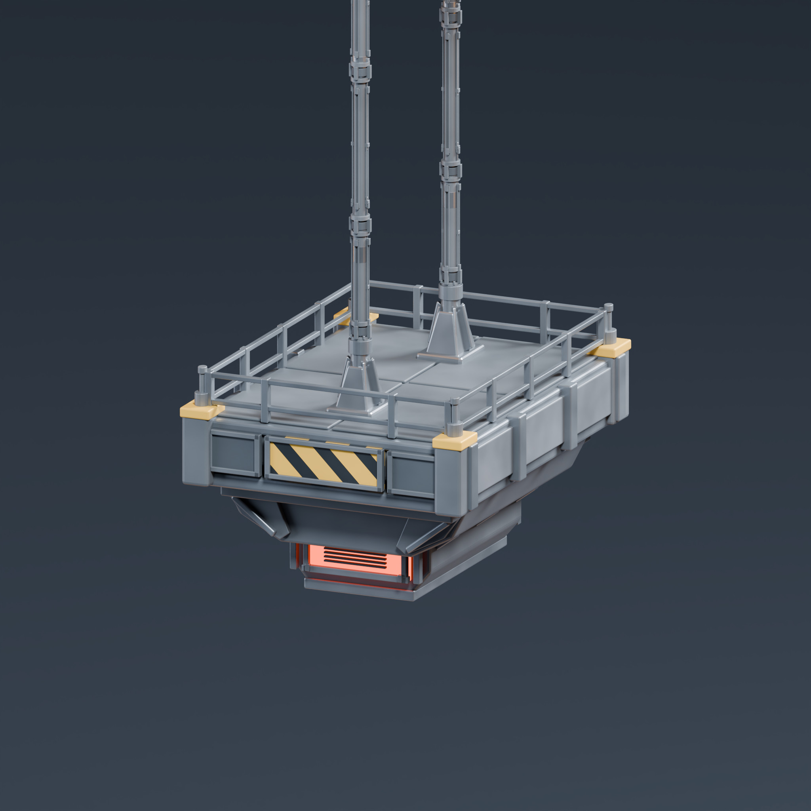

Saved scene: `05 | Detail - Suspended Core`. Original render: 2048 × 2048.

## 06 — Side platform, deck and mounting saddle

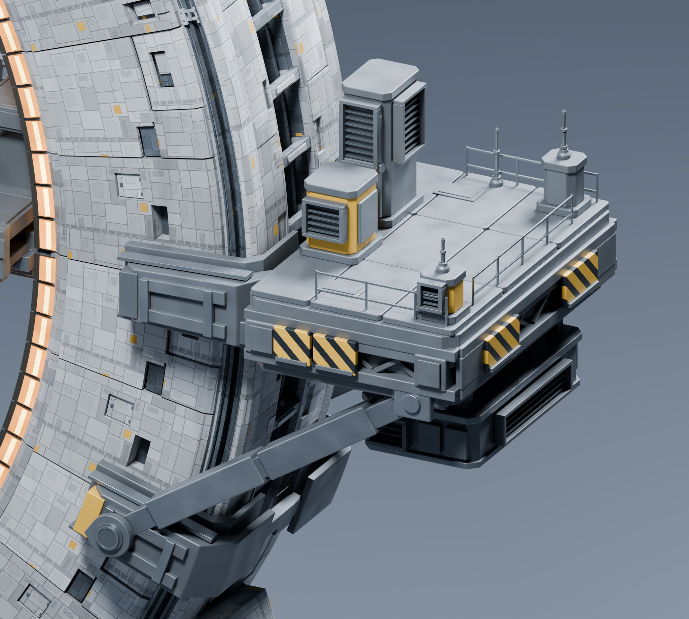

Saved scene: `06 | Detail - Side Platform`. Original render: 2400 × 2160.

## 07 — Platform underside, diagonal brace and service pod

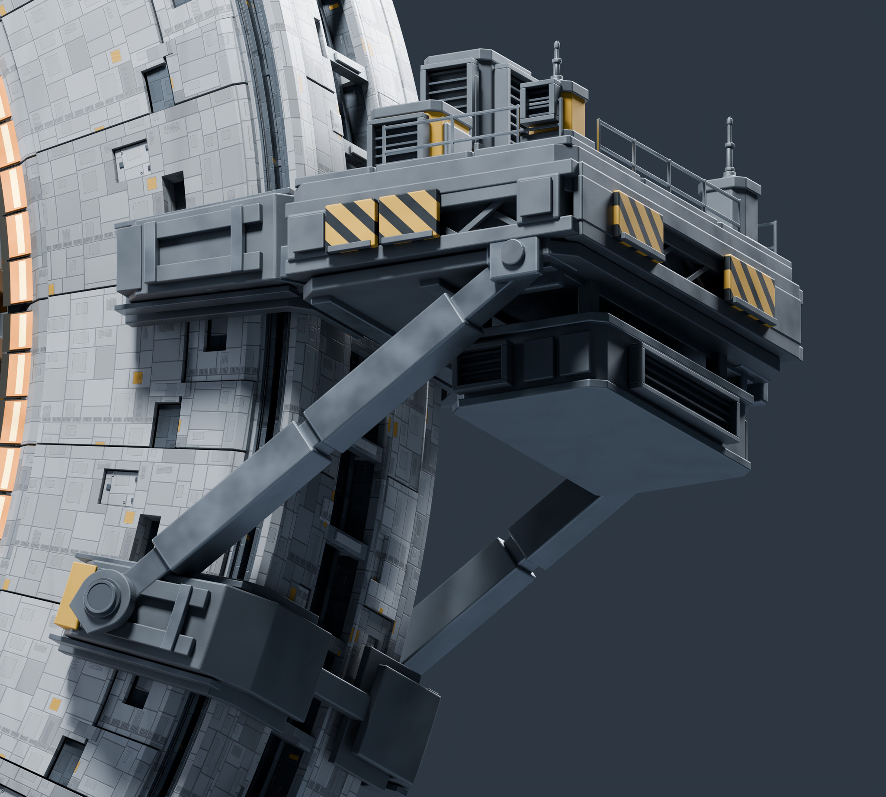

Saved scene: `07 | Detail - Platform Underside`. Original render: 2400 × 2160.

## 08 — Right foundation, supports and precision joints

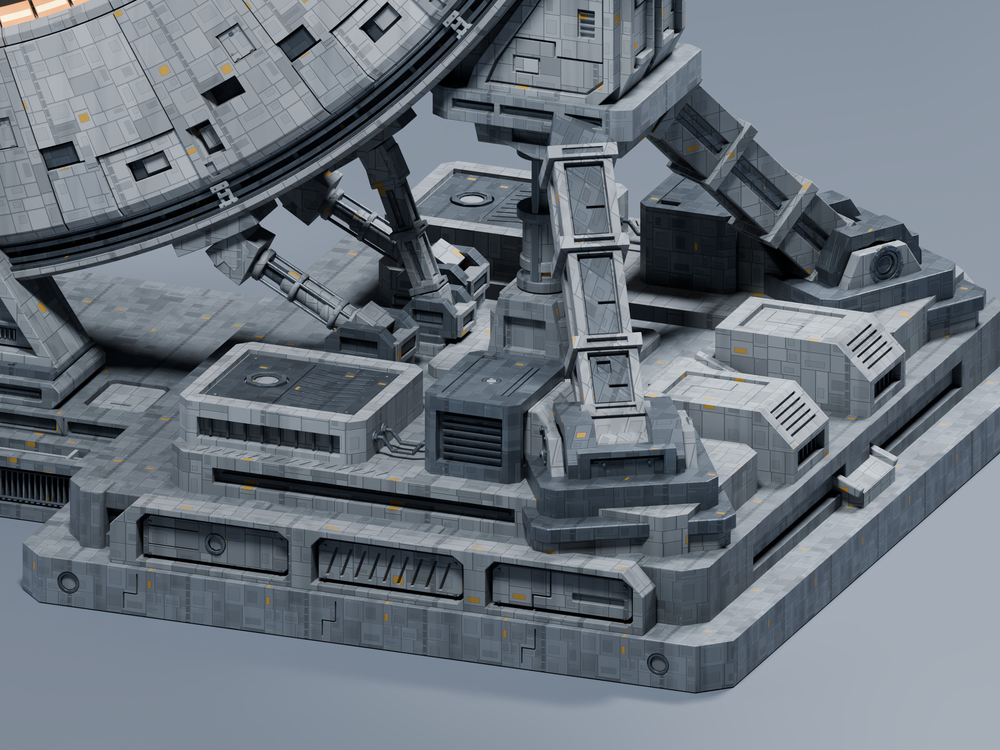

Saved scene: `08 | Detail - Base Assembly`. Original render: 2560 × 1920.

## 09 — Inner light channel, painted panels and rail layers

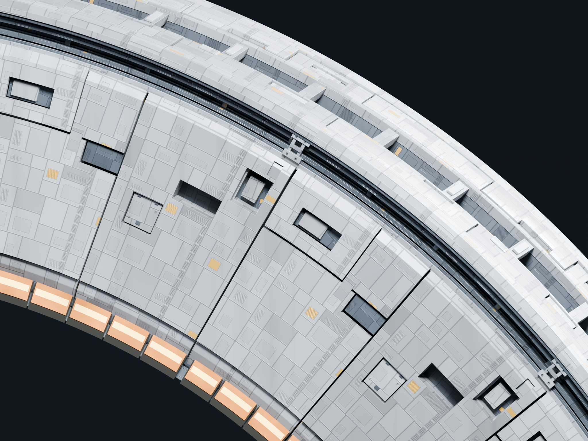

Saved scene: `09 | Detail - Inner Light Channel`. Original render: 2400 × 1800.

## 10 — Mechanical pivot, bearing and diagonal brace junction

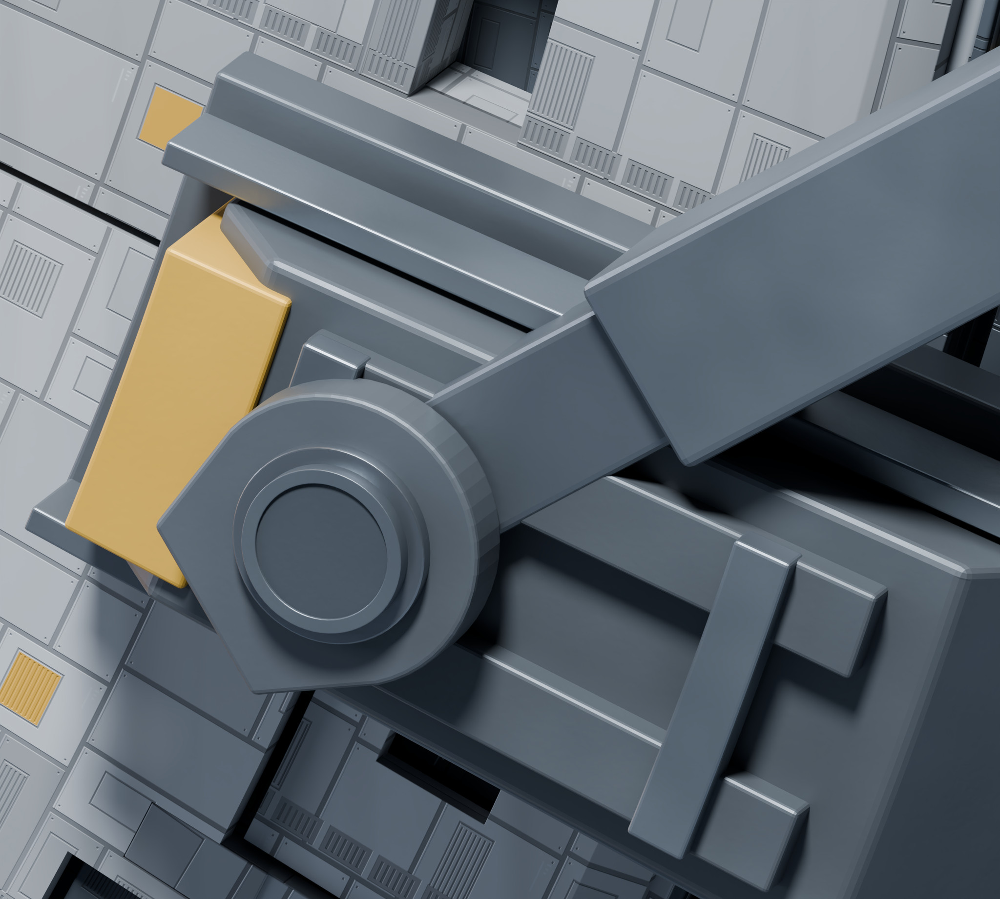

Saved scene: `10 | Detail - Mechanical Pivot`. Original render: 2400 × 2160.

---

# 中文说明

三张完整视角和七张零件细节均使用最终圆环几何，由 Blender 实际渲染。网页图片为压缩后的 JPEG 预览；原始渲染采用 16 位 RGB PNG、Cycles 和 192 采样。完整工程的十个展示场景保留了相机和灯光，可继续调整并重新渲染。

| 图片编号 | 内容 |
| --- | --- |
| 01 | [完整圆环三分之四视角](../assets/renders/01_Ring_ThreeQuarter.jpg) |
| 02 | [完整圆环正面](../assets/renders/02_Ring_Front.jpg) |
| 03 | [完整圆环背面](../assets/renders/03_Ring_Rear.jpg) |
| 04 | [顶部吊装与装甲板](../assets/renders/04_Upper_Crown.jpg) |
| 05 | [悬挂核心与维修平台](../assets/renders/05_Suspended_Core.jpg) |
| 06 | [侧平台与环抱连接](../assets/renders/06_Side_Platform.jpg) |
| 07 | [平台底部与斜撑](../assets/renders/07_Platform_Underside.jpg) |
| 08 | [基础、支撑与精密接头](../assets/renders/08_Base_Assembly.jpg) |
| 09 | [内圈灯槽与面板](../assets/renders/09_Inner_Light_Channel.jpg) |
| 10 | [机械转轴与轴承连接](../assets/renders/10_Mechanical_Pivot.jpg) |

[工程使用说明](Blender_Files_EN_CN.md) · [下载 Blender 工程](https://github.com/supercoderrrrr/AI_Blender/releases/tag/1.0)
